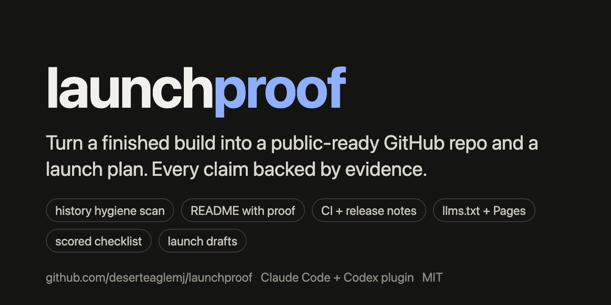
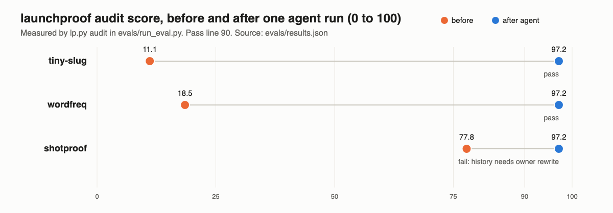

<p align="center">
  
</p>

<p align="center">
  <a href="https://github.com/deserteaglemj/launchproof/actions/workflows/tests.yml"></a>
  <a href="LICENSE"></a>
  <a href="evals/RESULTS.md"></a>
  
</p>

**launchproof is a Claude Code and Codex plugin that turns a finished project folder into a public-ready GitHub repo and a launch plan, with every claim backed by evidence in the repo.** It scans the whole git history for personal emails, home paths, secrets and private names, writes the README, community files, CI, llms.txt, AGENTS.md and a GitHub Pages page, scores the result with a checklist and fixes the gaps, then drafts posts for every launch channel that fits. It never pushes, publishes or posts: those steps come back to you as exact commands to approve.

## Install

Claude Code:

```bash
claude plugin marketplace add deserteaglemj/launchproof
```

```bash
claude plugin install launchproof@launchproof
```

Codex:

```bash
codex plugin marketplace add deserteaglemj/launchproof
```

```bash
codex plugin add launchproof@launchproof
```

Then, in your project folder, run `/launchproof` or ask "make this repo ready to publish on GitHub". To only check a repo, ask "audit this repo for launch". Needs Python 3.9 or newer (standard library only); `gitleaks` and `git-filter-repo` are used when installed.

## What a run looks like

1. **Hygiene scan** of every commit on the branch you will publish: author and committer emails that are not GitHub noreply addresses, personal emails, `/Users/<name>` style paths, 10 secret patterns, `.env` and key files, names from your private list, and every image for you to review.
2. **Proof**: runs your tests and evals and writes the numbers to a results file the README links to.
3. **Scaffold** of missing files (never overwrites): CONTRIBUTING, CODE_OF_CONDUCT, SECURITY, issue and PR templates, CHANGELOG, release notes, llms.txt, a Pages landing page with JSON-LD and Open Graph, robots.txt, sitemap, repo description and topics, social preview.
4. **README** in a fixed order: hero, demo, quickstart, how it works, proof, sourced comparison, limitations, FAQ written as the questions people ask AI assistants.
5. **Launch plan** in `docs/launch/LAUNCH-PLAN.md` plus a draft post per channel (Show HN, Reddit, X, LinkedIn, Product Hunt, Dev.to, Discord, awesome lists, plugin directories, newsletters), each marked as a draft awaiting your approval.
6. **Audit and fix loop**: `lp.py audit` scores 38 checks (0 to 100) and the agent fixes failures until the score is 90 or more.
7. **Report**: score before and after, pass, fail and unproven, and the owner-approval commands in order (history rewrite with backup, push, visibility, topics, Pages, release, each post).

## The proof



Each eval case is rebuilt from scratch and run headless with `claude -p`, with push, `gh`, history rewrites and web access denied. The harness measures the score itself; it does not trust the agent's report. Full table and method in [evals/RESULTS.md](evals/RESULTS.md):

- **wordfreq** (Python CLI with a personal author email, a home path and a deleted AWS-style key in its history): 18.5 before, 97.2 after the agent, 100.0 after the owner-approved rewrite. All 3 seeded problems found.
- **tiny-slug** (JavaScript library with no README, a client name, a personal email, a co-author email, a deleted `.env` and a client logo): 11.1 before, 97.2 after, 100.0 final. All 5 seeded problems found.
- **shotproof** (a real public plugin repo by the same author): 77.8 before, 97.2 after. It fails the fixed pass bar because the scan found a business name in older versions of two files in its public history, which only the owner can remove.

2 of 3 cases pass. In no case did the agent push, add a remote or rewrite history. Round 1 failed outright because of a skill-loading bug; that run is kept in [evals/history/round-1](evals/history/round-1/) and explained in the results file.

## How it compares

As of 2026-10. Each tool below is good at its own job; launchproof combines the steps and checks its own output. Details and scores in [docs/research/prior-art.md](docs/research/prior-art.md).

| Tool | What it does well | What it does not do |
|---|---|---|
| [gitleaks](https://github.com/gitleaks/gitleaks) | Mature secret scanning of git history, many more rules than launchproof | No emails, home paths, private names or repo docs. launchproof runs it when installed |
| [readme-ai](https://github.com/eli64s/readme-ai) | Generates a README from code with an LLM API | Needs a provider API key; no history scan, community files or launch plan |
| [Best-README-Template](https://github.com/othneildrew/Best-README-Template) | Widely used README layout | A static template: no checks, no evidence links |
| [OpenSSF Scorecard](https://github.com/ossf/scorecard) | Supply-chain security checks on public repos | Runs after publishing; does not write docs or plan a launch |
| [llms.txt](https://llmstxt.org) and [AGENTS.md](https://agents.md) | The formats for AI-readable project summaries | Formats only. launchproof writes both and checks llms.txt structure |

## Limitations

- **The audit checks structure and evidence links, not writing quality.** A README can pass and still read badly; review it yourself.
- **The secret scan uses 10 patterns.** Install gitleaks for wider coverage. Masked findings still need a human look.
- **History fixes need you.** launchproof never rewrites history; it prints the backup, rotation and git-filter-repo commands.
- **Small eval set**: 3 cases, one run each, and agent output varies between runs.
- **Launch-channel rules change.** Some channel facts come from secondary sources and are marked UNVERIFIED in the guide; check each channel's rules on the day you post.
- **Search and AI indexing are out of its control** and take days to weeks after publishing.

## FAQ

**How do I prepare a GitHub repo before making it public with Claude Code?** Install launchproof and run `/launchproof` in the project folder. It scans the full history, writes the missing files, scores the repo and lists the publish steps for you to approve.

**How do I check my git history for personal emails and secrets before open sourcing?** Run `python3 lp.py hygiene . --rev main` from the plugin's `scripts/` folder, or ask the agent to audit the repo. It checks every commit on that branch, including files that were deleted later.

**Is there a README generator for Claude Code or Codex that needs no API key?** Yes. launchproof runs on the model your Claude Code or Codex session already uses, and its helper script is standard-library Python.

**Does launchproof push or post anything for me?** No. Pushing, making a repo public, releases, Pages, topics, history rewrites and every launch post are listed as commands for you to approve and run.

**How do I write a launch plan for an open source project?** launchproof writes `docs/launch/LAUNCH-PLAN.md` with a dated sequence (Show HN, Reddit, X, LinkedIn, Product Hunt, Dev.to, directories, newsletters) and a draft for each channel, using only numbers from your README's proof section.

**How do I make my repo easier for AI assistants to find and cite?** Add an llms.txt, an AGENTS.md, a Pages landing page with JSON-LD and Open Graph, good topics, and a FAQ written the way people ask questions. launchproof creates and checks all of these.

**Does it work in Codex?** Yes. Add the marketplace with `codex plugin marketplace add deserteaglemj/launchproof` and install `launchproof@launchproof`; Codex loads the same skill and helper.

**What counts as passing?** A score of 90 or more from `lp.py audit` with no required check failing. Required checks: README, LICENSE, proof, no superlative claims, launch plan, and a clean hygiene scan of current files and history.

## Contributing, security, license

- [CONTRIBUTING.md](CONTRIBUTING.md) and [AGENTS.md](AGENTS.md) for setup and the test commands CI runs.
- Report vulnerabilities privately as described in [SECURITY.md](SECURITY.md).
- [MIT](LICENSE), copyright Marquis Jackson.

## Credits

Plugin layout follows [anthropics/claude-plugins-official](https://github.com/anthropics/claude-plugins-official). README order draws on [Best-README-Template](https://github.com/othneildrew/Best-README-Template) and [awesome-readme](https://github.com/matiassingers/awesome-readme); formats from [llms.txt](https://llmstxt.org) and [AGENTS.md](https://agents.md); the code of conduct adopts the [Contributor Covenant](https://www.contributor-covenant.org/). History fixes use [git-filter-repo](https://github.com/newren/git-filter-repo). The worked example is [shotproof](https://github.com/deserteaglemj/shotproof).
