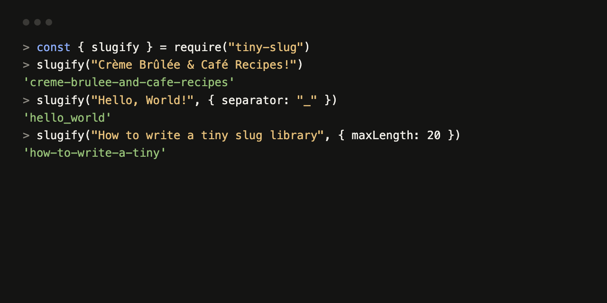

# tiny-slug

[](https://github.com/example-dev/tiny-slug/actions/workflows/ci.yml)
[](LICENSE)
[](https://github.com/example-dev/tiny-slug/releases)
[](evals/RESULTS.md)

**tiny-slug is a URL slug generator for Node.js developers: one 16-line function with no dependencies that turns any string into a lowercase ASCII slug, with a custom separator and a word-safe length limit.**



## Quickstart

tiny-slug is not on the npm registry yet. Install it straight from GitHub:

```sh
npm install github:example-dev/tiny-slug
```

Then call it:

```js
const { slugify } = require("tiny-slug");

slugify("Crème Brûlée & Café Recipes!");                       // "creme-brulee-and-cafe-recipes"
slugify("Hello, World!", { separator: "_" });                  // "hello_world"
slugify("How to write a tiny slug library", { maxLength: 20 }); // "how-to-write-a-tiny"
```

These three outputs come from running the code above against [index.js](index.js).

## Options

| Option | Default | What it does |
|---|---|---|
| `separator` | `"-"` | String placed between words. Use letters, digits, `-` or `_` (see Limitations). |
| `maxLength` | `0` (no limit) | Cut the slug to at most this many characters, then drop the trailing partial word. |

## How it works

1. Convert the input to a string and apply Unicode NFKD normalization, which splits `é` into `e` plus an accent mark.
2. Remove the accent marks (U+0300 to U+036F) and lowercase the result.
3. Replace `&` with ` and `.
4. Replace every run of characters outside `a-z0-9` with the separator, then trim separators from both ends.
5. If `maxLength` is set and the slug is longer, cut it and remove the trailing partial word.

## Proof

Measured on 2026-10-17 with Node.js v22.23.1. Full tables and reproduce steps: [evals/RESULTS.md](evals/RESULTS.md).

- **Unit tests:** 5 of 5 pass (`npm test`).
- **Edge-case eval:** 9 of 13 pass (`node evals/run.js`). Expected outputs were written before the first run. The 4 failures are listed under Limitations.

## How it compares

As of 2026-10, based on each project's own README. Re-check before relying on it.

| | tiny-slug | [slugify](https://github.com/simov/slugify) | [@sindresorhus/slugify](https://github.com/sindresorhus/slugify) | [github-slugger](https://github.com/Flet/github-slugger) |
|---|---|---|---|---|
| Purpose | ASCII URL slugs | ASCII URL slugs | ASCII URL slugs | GitHub-style heading anchors |
| Characters like `ß`, `ø` | Become separators | Character map with locale options | Transliteration | Kept as Unicode |
| Non-Latin scripts | Empty output | Partial, via character map | Transliteration for many scripts | Kept as Unicode |
| Custom replacements | No | Yes | Yes | No |
| Duplicate tracking | No | No | Yes, via a counter helper | Yes |
| Size | 16 lines in one file, readable in a minute | Larger, with a character map | Larger, with dependencies | Small |

Where the others are stronger: all three handle more of the world's text than tiny-slug. Pick tiny-slug when your input is mostly Latin-script text and you want code you can read in full and vendor into a project.

## Limitations

- `maxLength` drops one word too many when the cut lands exactly on a word boundary: `"one two three"` with `maxLength: 7` gives `"one"`, not `"one-two"`.
- The separator is used inside a regular expression without escaping, so separators such as `.` or `+` give wrong output (`"a b"` with `"."` gives `""`).
- Letters that Unicode normalization does not reduce to ASCII (`ß`, `ø`, `ł`, `æ`) become separators: `"Straße"` gives `"stra-e"`.
- Text in scripts without a Latin form (Japanese, Chinese, Arabic, Cyrillic) produces an empty string.
- CommonJS only (`require`); there is no ES module build or TypeScript types file.
- Tested only on Node.js v22 so far; the eval set is 13 cases.

## FAQ

**How do I make a URL slug from a string in Node.js?** Install tiny-slug with `npm install github:example-dev/tiny-slug`, then call `slugify("Your Title")` to get `"your-title"`. It lowercases, strips accents and joins words with `-`.

**Is there a slugify function for Node.js with no dependencies?** Yes, tiny-slug has no runtime dependencies. The whole function is 16 lines in [index.js](index.js), so you can also copy it into your project.

**How do I limit the length of a slug without cutting a word in half?** Pass `maxLength`: `slugify("How to write a tiny slug library", { maxLength: 20 })` returns `"how-to-write-a-tiny"`. Note the known bug when the cut lands exactly on a word boundary (see Limitations).

**How do I use underscores instead of hyphens in a slug?** Pass `{ separator: "_" }`. Letters, digits, `-` and `_` work; regex characters such as `.` do not yet.

**How is tiny-slug different from the slugify npm package?** tiny-slug is a single short function with no character map, so it is easy to audit but handles fewer characters. The [slugify](https://github.com/simov/slugify) package maps characters such as `ß` and supports locales and custom replacements.

**Does tiny-slug work with Chinese, Japanese or Cyrillic text?** No. Those inputs return an empty string. Use [@sindresorhus/slugify](https://github.com/sindresorhus/slugify), which transliterates many scripts, or keep Unicode slugs with [github-slugger](https://github.com/Flet/github-slugger).

**Does tiny-slug send my data anywhere?** No. It is a pure function with no network access, no file access and no dependencies.

**What does tiny-slug cost and what does it need?** It is free under the MIT license and needs Node.js; it has been tested on Node.js v22.

## Contributing

Bug reports and pull requests are welcome; see [CONTRIBUTING.md](CONTRIBUTING.md). The failing eval cases in [evals/RESULTS.md](evals/RESULTS.md) are good first fixes.

## Security

Report vulnerabilities privately as described in [SECURITY.md](SECURITY.md).

## License

[MIT](LICENSE). Changes are listed in [CHANGELOG.md](CHANGELOG.md).

## Credits

The normalize-then-strip-accents approach is a common JavaScript pattern; the projects in the comparison table solve the same problem more completely and are worth a look.
