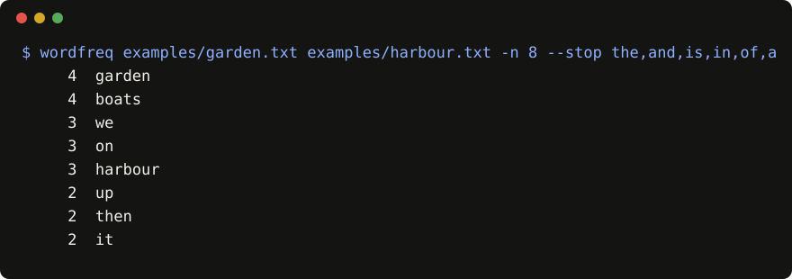

# wordfreq

[](https://github.com/example-dev/wordfreq/actions/workflows/ci.yml)
[](LICENSE)
[](CHANGELOG.md)
[](evals/RESULTS.md)

**wordfreq is a word frequency counter CLI for plain text files: it prints the most common words across one or more files, with stop-word filtering, using only the Python standard library.**



The image above is a real run on [`examples/`](examples/), rendered by [`scripts/make_demo.py`](scripts/make_demo.py).

## Quickstart

Needs Python 3.9 or newer. No third-party dependencies.

```sh
pip install git+https://github.com/example-dev/wordfreq
```

```sh
wordfreq examples/garden.txt examples/harbour.txt -n 5 --stop the,and,is,in,of,a
```

You should see a count and a word per line, most common first:

```text
     4  garden
     4  boats
     3  we
     3  on
     3  harbour
```

Without installing, from a clone: `python3 -m wordfreq.cli FILE... [-n N] [--stop w1,w2]`.

## How it works

1. Each file is read as UTF-8; bytes that are not valid UTF-8 are replaced instead of crashing.
2. Words are runs of ASCII letters and apostrophes (`[A-Za-z']+`), lower-cased, with leading and trailing quotes stripped, so `don't` stays one word and `'hello'` becomes `hello`.
3. Words in `--stop` (comma-separated, case-insensitive) are dropped.
4. Counts from all files are summed and the top `-n` (default 10) are printed. Ties keep first-seen order.

## Proof

Results from [`evals/RESULTS.md`](evals/RESULTS.md), produced by `python3 evals/run.py` on 2026-10-17 (Python 3.9.6, macOS):

- **9/10 eval cases passed.** Cases and pass criteria are fixed in [`evals/cases.json`](evals/cases.json): exit code 0 and exact stdout match.
- The failing case is `accented-word`: `café café` is counted as `caf`, because the word pattern is ASCII-only. It is listed under Limitations.
- The unit tests in [`tests/`](tests/) (3 tests) run in CI with `python3 -m unittest discover -v`.

## How it compares

As of 2026-10. Sources are each tool's own page.

| Tool | What it is | Where it is stronger than wordfreq |
|---|---|---|
| Shell pipeline (`tr` / `sort` / `uniq -c`, [GNU coreutils](https://www.gnu.org/software/coreutils/manual/coreutils.html)) | Composable Unix commands | Already installed on most systems; streams very large inputs |
| [`collections.Counter`](https://docs.python.org/3/library/collections.html#collections.Counter) | Python standard library class | Full control in your own code; wordfreq is a thin CLI over it |
| [NLTK `FreqDist`](https://www.nltk.org/api/nltk.probability.FreqDist.html) | Part of a full NLP toolkit | Real tokenizers, Unicode, built-in stop-word lists, plots |
| [rspeer/wordfreq](https://github.com/rspeer/wordfreq) (same name, unrelated) | Library of word frequencies in many languages, built from large corpora | Answers "how common is this word in English"; this project only counts words in your files |

wordfreq's niche: one install-free command that counts across several files with a stop list, no dependencies. Nothing here was benchmarked against these tools.

## Limitations

- ASCII letters only: accented and non-Latin words are split or dropped (`café` becomes `caf`). See the failing eval case.
- Hyphenated words and numbers are not words: `well-known` counts as `well` and `known`; `42` is ignored.
- Each file is read fully into memory; very large files need enough RAM.
- No stemming or lemmatising: `bean` and `beans` are counted separately.
- No built-in stop-word list; pass your own with `--stop`.
- The eval set is small (10 cases) and checks behaviour, not speed.
- The name collides with the unrelated PyPI package [`wordfreq`](https://pypi.org/project/wordfreq/); this project is not published to PyPI, so install it from GitHub as shown above.

## FAQ

**How do I count word frequency in a text file from the command line?** Install wordfreq and run `wordfreq yourfile.txt`. It prints the 10 most common words with their counts; use `-n 50` to show more.

**How do I ignore common words like "the" and "and" when counting?** Pass them with `--stop`, for example `wordfreq book.txt --stop the,and,a,of`. Matching is case-insensitive.

**Can I count words across many files at once?** Yes. Pass several files or a shell glob (`wordfreq notes/*.txt`); the counts are summed into one list.

**Is there a word counter that needs no dependencies?** wordfreq uses only the Python standard library, so it needs Python 3.9+ and nothing else.

**How is this different from the `wordfreq` package on PyPI?** They are unrelated. The PyPI package (rspeer/wordfreq) looks up how common a word is in a language; this tool counts words in files you give it.

**How is this different from `sort | uniq -c`?** It does the lower-casing, punctuation handling, stop words and top-N in one command. The shell pipeline is already installed and handles inputs larger than memory.

**Does it work with non-English text?** Only partly. Words with letters outside A to Z are split (`café` becomes `caf`), so results for most other languages are wrong today.

**Does wordfreq send my text anywhere?** No. It reads local files and prints to the terminal; there is no network code.

**What does it cost?** Nothing. It is MIT-licensed.

## Contributing, security, license

- Contributing: see [CONTRIBUTING.md](CONTRIBUTING.md) and [AGENTS.md](AGENTS.md) for the test commands.
- Security: report privately as described in [SECURITY.md](SECURITY.md).
- Code of conduct: [CODE_OF_CONDUCT.md](CODE_OF_CONDUCT.md).
- License: [MIT](LICENSE).
- Credits: built on Python's [`collections.Counter`](https://docs.python.org/3/library/collections.html#collections.Counter) and `argparse`.
